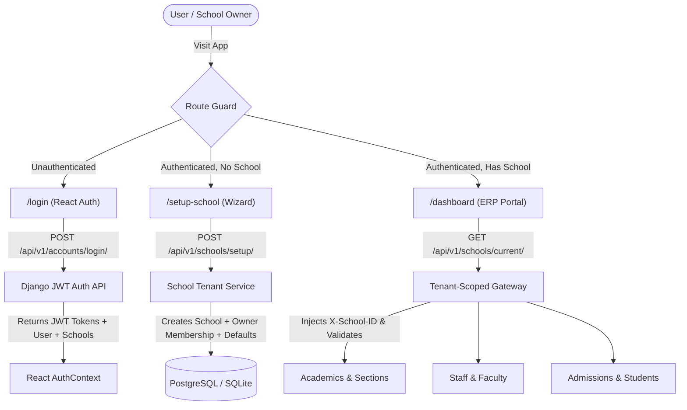

# Darsentra ERP — Phase 2 Architecture & Implementation Plan

> **Phase Focus**: Complete User Authentication, Multi-Tenant School Onboarding Wizard, Core Academic Structure, Staff Directory, Student Admissions, and the School Owner SaaS Dashboard.

---

## 1. Executive Summary & Objective

In **Phase 1 (Foundation)**, we established:
- The modular Django backend monolith with multi-tenant row-level isolation (`School`, `SchoolMembership`, `User`).
- Consistent JSON error handling and `/api/v1/health/` telemetry.
- React TypeScript frontend with Tailwind CSS and shadcn/ui foundation.
- Full automated test suite (14/14 tests passing).

**Phase 2 Objective**:
Transform Darsentra ERP into a fully interactive SaaS platform where a School Owner or Principal can:
1. Log in via a modern React interface (`/login`).
2. Run through a guided **School Setup Wizard** (`/setup-school`) to configure their campus, curriculum, and class structure.
3. Access an interactive **School ERP Dashboard** (`/dashboard`) scoped strictly to their tenant.
4. Onboard teachers and admit students with Pakistani K-12 compliant records (B-Form, Guardian CNIC, BISE/Cambridge streams).

---

## 2. Architecture & Data Flow

---

## 3. Detailed Phase 2 Implementation Epics

### Epic 1: JWT Authentication & Account Workflows

#### Backend (`apps.accounts`)
- Install `djangorestframework-simplejwt` for industry-standard JWT token lifecycle.
- **API Endpoints**:
  - `POST /api/v1/accounts/token/` (Login with Email + Password -> Access Token, Refresh Token, User Summary, Active Memberships).
  - `POST /api/v1/accounts/token/refresh/` (Token rotation).
  - `POST /api/v1/accounts/register/` (School Founder self-registration).
  - `GET /api/v1/accounts/me/` (Current user profile with active school context).
  - `POST /api/v1/accounts/change-password/`.

#### Frontend (`features/accounts`)
- **Auth State Management** (`src/context/AuthContext.tsx`):
  - Stores user profile, active token, and active school selection.
  - Automatically attaches `Authorization: Bearer <token>` and `X-School-ID: <active_school_id>` to all Axios requests.
- **Pages**:
  - `/login`: Premium enterprise login page with remember-me, password toggle, and validation error messages.
  - `/register`: School owner sign-up.
- **Route Protections** (`src/components/auth/ProtectedRoute.tsx`):
  - Automatically redirects unauthenticated users to `/login`.
  - Automatically redirects authenticated users without an active school to `/setup-school`.

---

### Epic 2: School Setup & Onboarding Wizard

#### Backend (`apps.schools`)
- **API Endpoints**:
  - `POST /api/v1/schools/setup/`: Atomic transaction that creates the school, assigns the creator as `OWNER`, and seeds standard classes (e.g. Nursery through Grade 10 / O-Levels).
  - `GET /api/v1/schools/active/`: Details of the currently active school context.
  - `PATCH /api/v1/schools/{id}/profile/`: Update contact info, logo, address, and registration numbers.

#### Frontend (`features/schools/onboarding`)
- **4-Step Setup Wizard** (`/setup-school`):
  1. **Institution Profile**: School Name, Branch/Campus Name (e.g., *Margalla Campus*), Institutional Code (`IMC-01`), Registration Number (PEIRA, BISE).
  2. **Curriculum Stream**: Select from *Matric/FSc (BISE)*, *Cambridge (O/A Levels)*, *Federal Board (FBISE)*, or *Combined Stream*.
  3. **Academic Session**: Current academic year (e.g., `2026-2027`), session start and end dates.
  4. **Initial Grade Setup**: Checkboxes to auto-generate class levels (e.g. Early Years, Primary, Middle, Secondary).

---

### Epic 3: Core Academics Hierarchy

#### Backend (`apps.academics`)
- **Domain Models** (`TenantScopedModel`):
  - `AcademicYear`: Session code (`2026-2027`), `start_date`, `end_date`, `is_current`.
  - `AcademicClass`: Grade level (`Class 1`, `Class 9`, `O-1`, `HSSC-I`), numerical rank.
  - `Section`: Campus section (`Section A - Rose`, `Section B - Jasmine`), room capacity.
  - `Subject`: Subject title (`Mathematics`, `General Science`, `Urdu`, `Pak Studies`, `Islamiyat`), code.
  - `ClassSubject`: Mapping of subjects to classes with weekly periods.
- **API Endpoints**:
  - `/api/v1/academics/sessions/`
  - `/api/v1/academics/classes/`
  - `/api/v1/academics/sections/`
  - `/api/v1/academics/subjects/`

#### Frontend (`features/academics`)
- Interactive Class & Section manager.
- Subject allocation table.

---

### Epic 4: Staff & Faculty Directory

#### Backend (`apps.staff`)
- **Domain Models** (`TenantScopedModel`):
  - `Department`: `Science`, `Humanities`, `Mathematics`, `Administration`, `Sports`.
  - `StaffProfile`: Foreign key to `User`, Employee ID, designation, qualification, CNIC, join date.
  - `TeacherAssignment`: Maps a teacher to a specific Class + Section + Subject.
- **API Endpoints**:
  - `/api/v1/staff/` (List, create, update staff records).
  - `/api/v1/staff/assignments/` (Class & subject teacher assignments).

#### Frontend (`features/staff`)
- Faculty directory with searchable table, status filters, and designation badges.
- "Add Staff" modal dialog with instant user account provisioning.

---

### Epic 5: Student Admissions & Directory

#### Backend (`apps.students`)
- **Domain Models** (`TenantScopedModel`):
  - `StudentProfile`: Admission number (GR Number), roll number, date of birth, gender, blood group, B-Form number.
  - `Guardian`: Full name, CNIC, mobile number, emergency contact, relationship (`Father`, `Mother`, `Legal Guardian`).
  - `Enrollment`: Links student to an `AcademicClass`, `Section`, and `AcademicYear` with status (`Active`, `Promoted`, `Withdrawn`).
- **API Endpoints**:
  - `/api/v1/students/admissions/` (Transactional admission with student and guardian records).
  - `/api/v1/students/` (Filterable directory by class, section, and status).

#### Frontend (`features/students`)
- Pakistani K-12 compliant admission intake form (with B-Form validation and guardian details).
- Class roster views with exportable list.

---

### Epic 6: School Owner & Principal SaaS Dashboard

#### Frontend (`features/dashboard`)
- Replaces the Phase 1 minimal placeholder with an enterprise SaaS command center:
  - **Campus Switcher**: Header control to switch between multiple campuses (for group owners).
  - **Executive KPI Cards**:
    - Total Enrolled Students
    - Total Faculty & Staff
    - Active Classes & Sections
    - Current Academic Term & Session
  - **Quick Action Speed-Dial**:
    - New Student Admission
    - Onboard Faculty Member
    - View Class Timetable
    - Create Academic Term
  - **Recent Activity Feed**: Real-time log of recent admissions and staff additions.

---

## 4. Work Breakdown & Milestones

| Milestone | Deliverables | Estimated Steps |
|---|---|---|
| **M1: Auth & Token Foundation** | `simplejwt` integration, `/api/v1/accounts/token/`, React `AuthContext`, `/login` and `/register` pages. | Steps 1 – 3 |
| **M2: School Onboarding Wizard** | `/setup-school` 4-step wizard, atomic school creation API, initial class generator. | Steps 4 – 5 |
| **M3: Enterprise Dashboard** | Interactive `/dashboard` with KPI cards, campus switcher, and quick action drawer. | Steps 6 – 7 |
| **M4: Academics & Sections** | Models, serializers, and UI for Academic Years, Classes, Sections, and Subjects. | Steps 8 – 9 |
| **M5: Staff & Student Admissions** | Staff profiles, Teacher assignments, Student admission flow with Guardian records. | Steps 10 – 12 |
| **M6: Verification & Test Suite** | Automated integration tests for all new endpoints, linting, and full build check. | Step 13 |

---

## 5. Security & Multi-Tenant Invariants Maintained

1. **Strict Scoping**: Every new model (`AcademicYear`, `AcademicClass`, `Section`, `StaffProfile`, `StudentProfile`) inherits directly from `TenantScopedModel`.
2. **Context Integrity**: The frontend `apiClient` automatically sends `X-School-ID`. The backend's `TenantSecurityService` validates that the authenticated user holds an active membership before executing any query.
3. **No Cross-Tenant Leaks**: Automated test coverage will verify that School A's students and teachers are completely invisible to School B.
